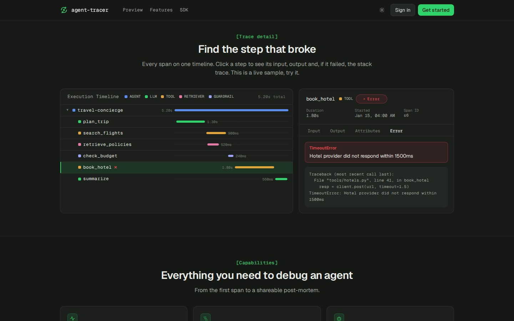

# Agent Tracer

Agent Tracer shows what happened inside an AI agent run. Follow model and tool calls in a trace waterfall, inspect timing, token usage, cost, and errors, then compare runs or score them against a dataset.

[Open Agent Tracer](https://agent-tracer.ericzwierzynski.dev)



## How it works

The Python SDK sends traces to a FastAPI backend that stores them in PostgreSQL. The React dashboard streams updates as runs happen. You can replay a model call without rerunning its tools, or share a summary of a trace's metrics.

## Run locally

Requires Docker with the Compose plugin. Copy the example environment file, then set a long random `SECRET_KEY`, `WEB_PORT=3001`, and `API_PORT=8001` in `.env`.

```sh
cp .env.example .env
# Edit .env before starting the stack.
docker compose up --build -d
docker compose run --rm seed
```

Open [localhost:3001](http://localhost:3001) and sign in to the seeded Travel Concierge project with `demo@agenttracer.dev` and `demo-password` (or your local `DEMO_PASSWORD`). The seed command prints a project key for SDK experiments. Run `docker compose down` when finished.

[SDK quick start](sdk/README.md) · [Project reference](docs/reference.md) · [Deployment](docs/DEPLOYMENT.md) · [MIT license](LICENSE)
